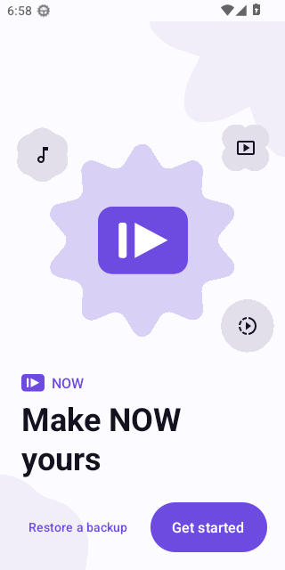
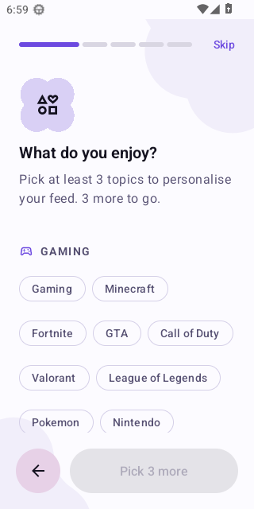
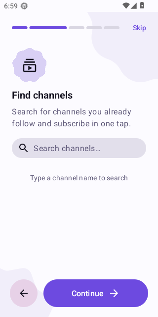
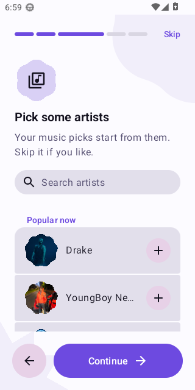

<div align="center">

# RTQ NOW

**An experimental Android app that puts YouTube, Spotify browsing and a local music library in one interface.**

Developer: [RTQ_67 on Telegram](https://t.me/RTQ_67)

[Download the APK](https://github.com/Mkjyyym/RTQ-NOW/releases/latest) · [Source code](https://github.com/Mkjyyym/RTQ-NOW)

</div>

<p align="center">
  
  
  
  
</p>

<p align="center"><sub>Real screenshots from the published APK running on an Android 13 emulator (first-run setup screens).</sub></p>

## What it is

RTQ NOW is an experimental build based on [Flow](https://github.com/Flow-Tube/Flow), a YouTube and YouTube Music client for Android. It adds two things on top:

- **Spotify (browse only, not yet verified):** the code is written so that you sign in with your own Spotify account in a built-in web view, then see your saved tracks and search. The intended path is to match each track to YouTube and play it through the app's player. No audio is meant to come from Spotify itself. None of this has been run end to end yet.
- **Local music library (not yet verified):** a library view for music files on your phone (songs, albums, artists, search), built on the app's existing local media player. Some of its code is adapted from [Symphony](https://github.com/zyrouge/symphony).

## Status

This is an experimental build. Here is what has and has not been checked.

| Area | Status |
| --- | --- |
| Builds on GitHub Actions | Yes |
| Installs and starts on an Android 13 emulator | Yes |
| First-run setup screens (welcome, topics, channels, artists, notifications, import) | Seen working on the emulator |
| Home, settings, About screen | Not tested on a device or emulator yet |
| Local music playback | Not tested yet |
| Spotify sign-in, saved tracks, matching to YouTube | Not tested yet |
| Backup and restore | Not tested yet |

If you hit a problem, please open an issue.

## Install

1. Download `app-github-universal-debug.apk` from the [latest release](https://github.com/Mkjyyym/RTQ-NOW/releases/latest). It contains builds for arm64-v8a, armeabi-v7a, x86 and x86_64. Smaller per-architecture files are listed there too. It has only been run on an x86_64 emulator, so it is not guaranteed to work on every phone.
2. Allow installs from your browser or file manager when Android asks.
3. Open RTQ NOW.

Requires Android 8.0 (API 26) or newer. The package name is `app.rtqnow.debug`.

**Updating note:** these test builds are signed with a temporary debug key that changes on every build. Android will refuse to install a build over one signed with a different key. Before replacing an older RTQ NOW install, export your data from Settings > Backup inside the app. Restoring a backup has not been tested yet.

## Build from source

```
./gradlew :app:assembleGithubDebug
```

The `RTQ NOW APK` workflow in this repository builds the APK on GitHub Actions and attaches it to a release.

## Credits and licenses

- RTQ NOW is based on **Flow** by A-EDev and contributors (https://github.com/Flow-Tube/Flow). The [License](License) file in this repository is the GNU General Public License v3. The original copyright and license notices are kept in the source files.
- The files under `app/src/main/java/io/github/sonic_liberation/` carry GNU Affero General Public License v3 headers (copyright Sonic Liberation). They come from [spotube-plugin-spotify](https://github.com/sonic-liberation/spotube-plugin-spotify), and the Spotify session code in `app/src/main/java/io/github/aedev/flow/spotify/` notes that it is ported from the same project (AGPL-3.0).
- The files under `app/src/main/java/io/github/aedev/flow/symphony/` say they are adapted from [Symphony](https://github.com/zyrouge/symphony) (copyright Zyrouge, AGPL-3.0).
- Check the header of each source file for its own notice. This README is not legal advice.
- This project is not affiliated with Google, YouTube or Spotify.
